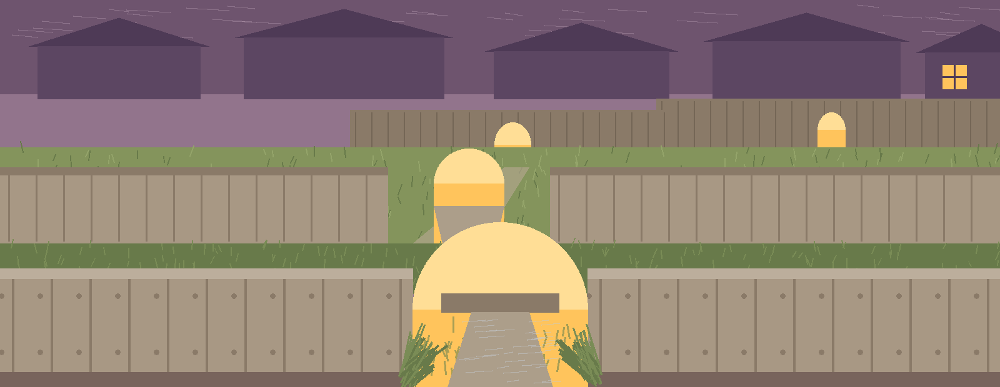

# dm-data-format-randomizer

Title block: the name above is set in Caveat in dusk mauve, arranged like a field guide entry, everyday name leading, with a tiny arch sketch set at its left margin beside this earliest heading only and plain type from there on.

# dm-data-format-randomizer
Randomly changes the format of data fields to one of several predefined formats (e.g., different date formats, phone number formats, address formats), providing data variety while masking the original format. - Focused on Tools designed to generate or mask sensitive data with realistic-looking but meaningless values

## Install
`git clone https://github.com/ShadowStrikeHQ/dm-data-format-randomizer`

> Plant label: the install line names an older organisation. It stands as published here, and the website corrects it in the open with the correction labelled.

## Usage
`./dm-data-format-randomizer [params]`

> Plant label: no behavior notes exist in this README. Nothing in the live file adds rules beyond the chapters printed here.

> Plant label: no exit code is printed anywhere in it. No failure in this file carries a stated code.

## Parameters
- `-h`: Show help message and exit
- `-t`: No description provided
- `-n`: The number of samples to generate. Defaults to 1.
- `-l`: The Faker locale to use. Defaults to en_US.

> Plant label: one listed control has no printed description. The `-t` line above stands exactly as the live file prints it, with the gap stated and nothing invented to fill it.

## License
Copyright (c) ShadowStrikeHQ

## Plant labels gathered along the fence

The main button of this re-skin reads Randomize the Formats. Its samples field label reads Number of Samples. Its locale field label reads Faker Locale. Its gap heading reads One Control Has No Printed Purpose. Its absence heading reads What This README Does Not State. Night closes the walk: lamplight behind the farthest arch, the gardens locked up by their owners, and the low passage still threading through all of them, open to whatever travels small.
